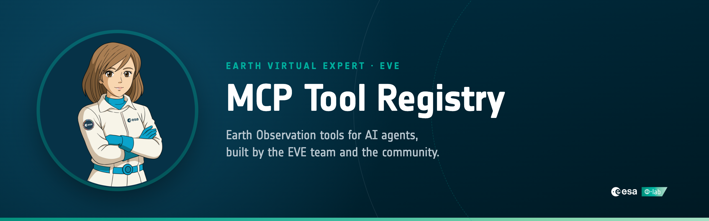

<div align="center">



<br/>

**Open MCP servers that give AI agents access to Earth Observation data, imagery and knowledge.**

[](https://github.com/eve-esa/mcp-tool-registry/actions/workflows/pr-checks.yml)
[](LICENSE)
[](https://www.python.org/)
[](https://modelcontextprotocol.io/)
[](https://arxiv.org/abs/2604.13071)

[Servers](#servers) · [Quick start](#quick-start) · [Contributing](#contributing) · [EVE](#earth-virtual-expert-eve) · [Citation](#citation)

</div>

## About

The [Model Context Protocol](https://modelcontextprotocol.io/) (MCP) is an open standard that lets an AI agent discover and call external tools.
This repository is the tool registry of [EVE, the Earth Virtual Expert](https://eve.philab.esa.int/): a collection of MCP servers for Earth Observation (EO) and Earth Science, written by the EVE team and the community.

- **One folder per server.** Each server in `servers/` is self-contained: a FastMCP entrypoint, pinned requirements and optional tests.
- **Checked on every pull request.** CI validates the structure, lints the code, scans for secrets and builds the container.
- **Deployed to EVE.** Merged servers are deployed to AWS Bedrock AgentCore and become tools for the EVE agent.

Anyone building EO agents can run these servers locally or contribute a new one.

## Servers

| Server | What it does | Tools | Credentials |
|---|---|---|---|
| [`cdse`](servers/cdse) | Sentinel-1, -2, -3, -5P, Landsat and DEM imagery from the Copernicus Data Space Ecosystem (Sentinel Hub) | `fetch_sentinel1_grd`, `fetch_sentinel2`, `fetch_sentinel3_olci`, `fetch_sentinel3_slstr`, `fetch_sentinel3_syn_l2`, `fetch_sentinel5p_l2`, `fetch_landsat_ot_l1`, `fetch_dem` | CDSE client |
| [`effis`](servers/effis) | Burnt areas from EFFIS and Sentinel-2 burn metrics (NDVI, NBR, BAIS2) | `geocode_place`, `get_effis_burnt_areas`, `compute_metrics` | CDSE client |
| [`eodashboard`](servers/eodashboard) | ESA / NASA / JAXA EO Dashboard narratives and indicators, resolved to STAC items | `list_narratives`, `search_narratives`, `get_narrative_content`, `list_themes`, `get_narrative_indicators`, `search_collections`, `get_collection_items`, `find_narratives_for_indicator` | none |
| [`eotdl`](servers/eotdl) | Search datasets, models and pipelines on the EO Training Data Lab | `eotdl_search` | none |
| [`esa_moocs`](servers/esa_moocs) | Semantic search over ESA Earth Observation MOOC transcripts | `search_moocs` | none |
| [`eve_retrieval`](servers/eve_retrieval) | Retrieval over the EVE document collections | `retrieve` | EVE token |
| [`gdacs`](servers/gdacs) | Ongoing and recent natural disasters worldwide (GDACS, UN / EC) | `search_gdacs_events` | none |
| [`geocode`](servers/geocode) | Forward and reverse geocoding with OpenStreetMap Nominatim | `geocode_place`, `reverse_geocode_place` | none |
| [`serpapi`](servers/serpapi) | Web search through SerpAPI | `search_google` | SerpAPI key |
| [`trallie`](servers/trallie) | Structured data extraction from documents with an LLM | `extract_data` | Groq API key |
| [`dummy_image`](servers/dummy_image) | Sample PNG images, to test MCP image responses | `get_sample_image` | none |

## Quick start

Requires Python 3.13. Each server has its own requirements, so install only the one you need:

```bash
git clone https://github.com/eve-esa/mcp-tool-registry.git
cd mcp-tool-registry
python3 -m venv .venv && source .venv/bin/activate
pip install -r servers/geocode/requirements.txt
```

Servers that need credentials ship a `.env.template`: copy it to `.env` in the same folder and fill it in. Some also accept them per request as HTTP headers, see [Per-request credential headers](CONTRIBUTING.md#per-request-credential-headers-proxy-mode).

**Run over HTTP** (streamable HTTP on `http://localhost:8000/mcp`, the default):

```bash
python servers/geocode/server.py
```

**Use it from an MCP client** (stdio), for example Claude Desktop, Cursor or VS Code:

```json
{
  "mcpServers": {
    "geocode": {
      "command": "/absolute/path/to/mcp-tool-registry/.venv/bin/python",
      "args": ["/absolute/path/to/mcp-tool-registry/servers/geocode/server.py", "--transport", "stdio"]
    }
  }
}
```

The [MCP Inspector](https://github.com/modelcontextprotocol/inspector) (`npx @modelcontextprotocol/inspector`) is the quickest way to list and call the tools of a running server. For curl examples and Docker builds, see [Local testing](CONTRIBUTING.md#local-testing).

## Contributing

New EO tools are welcome. In short:

1. Create `servers/<your-server>/` with a FastMCP `server.py` and a pinned `requirements.txt`.
2. Add a `.env.template` if the server needs secrets, and a `test.py`.
3. Run it locally and build it with `docker build -f shared/Dockerfile servers/<your-server>/`.
4. Open a pull request against `main`, one server per PR.

CI checks the folder structure, the entrypoint contract, pinned versions, secrets and file sizes, then runs `ruff` and a Docker build.
The full guide, with a server template and the PR checklist, is in **[CONTRIBUTING.md](CONTRIBUTING.md)**.

## Deployment and early access

Servers merged into `main` are deployed automatically to AWS Bedrock AgentCore, where the EVE agent uses them.
If you want early access to the hosted servers before they are public, write to **eve@picampus-school.com**.

## Earth Virtual Expert (EVE)

**Earth Virtual Expert (EVE)** aims to advance the use of Large Language Models (LLMs) within the Earth Observation (EO) and Earth Science (ES) community.

- Website: https://eve.philab.esa.int/
- Hugging Face: https://huggingface.co/eve-esa
- Other repositories: https://github.com/eve-esa

## Funding

This project is supported by the European Space Agency (ESA) Φ-lab through the Large Language Model for Earth Observation and Earth Science project, as part of the Foresight Element within FutureEO Block 4 programme.

## Citation

If you use this project in academic or research settings, please cite:

```bibtex
@misc{atrio2026evedomainspecificllmframework,
      title={{EVE}: A Domain-Specific {LLM} Framework for Earth Intelligence},
      author={Àlex R. Atrio and Antonio Lopez and Jino Rohit and Yassine El Ouahidi and Marcello Politi and Vijayasri Iyer and Umar Jamil and Sébastien Bratières and Nicolas Longépé},
      year={2026},
      eprint={2604.13071},
      archivePrefix={arXiv},
      primaryClass={cs.CL},
      url={https://arxiv.org/abs/2604.13071},
}
```

## License

This project is released under the Apache 2.0 License. See the [LICENSE](LICENSE) file for details.

<br/>

<div align="center">
  <a href="https://philab.esa.int/">
    <picture>
      <source media="(prefers-color-scheme: dark)" srcset="docs/assets/esa-phi-lab-dark.png">
      
    </picture>
  </a>
  <br/>
  <sub>Funded by ESA Φ-lab. Developed by <a href="https://picampus-school.com/">Pi School</a> with <a href="https://www.imperative.space/">Imperative Space</a> and <a href="https://mistral.ai/">Mistral AI</a>.</sub>
</div>
